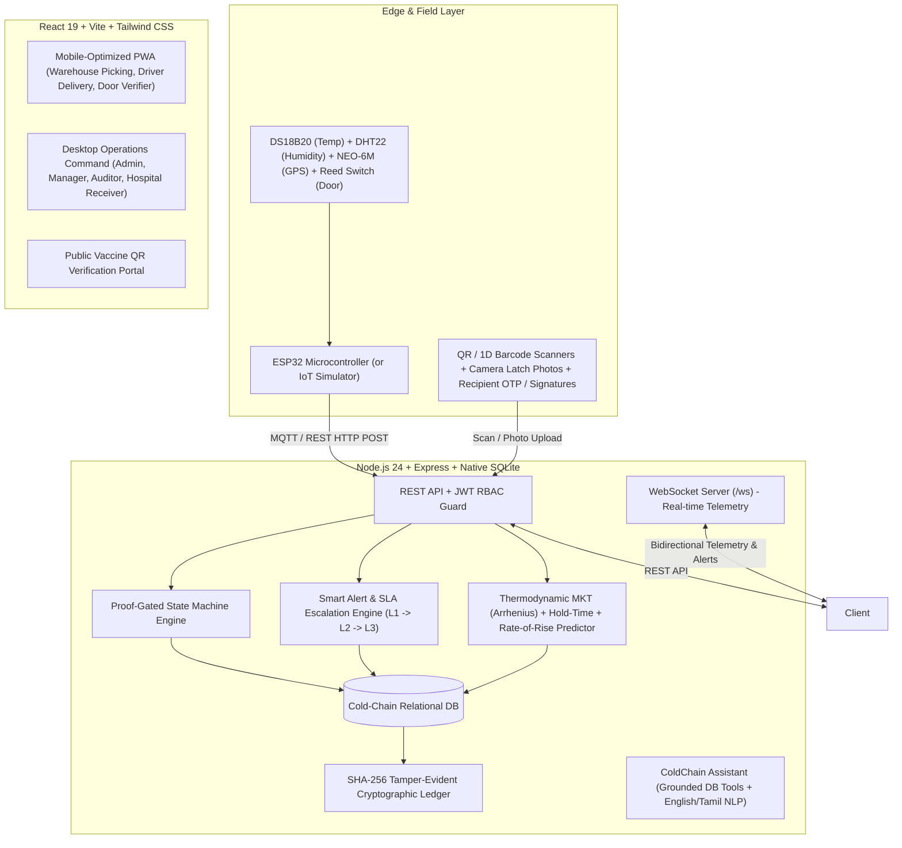
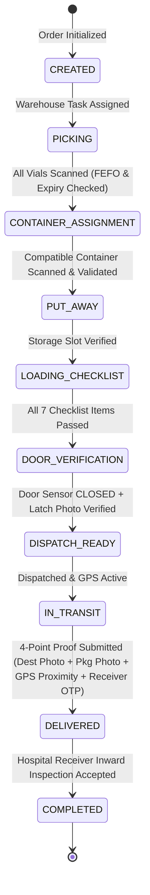

# System Architecture & Technical Specification

## Smart Cold-Chain Monitoring and Response Platform for Vaccines and Temperature-Sensitive Medicines

### Tagline
**Monitor → Scan → Validate → Guide → Perform → Verify → Track → Deliver → Record**

---

## 1. High-Level Architecture

---

## 2. Proof-Gated Workflow Engine (State Machine)
The core differentiator of this platform is that physical actions cannot simply be marked "done". They require unforgeable proof:
$$\text{ACTION} \xrightarrow{\text{PROOF}} \text{VERIFICATION} \xrightarrow{\text{SUCCESS}} \text{NEXT STAGE UNLOCKED}$$

---

## 3. Product-Safety & Predictive Analytics Algorithms

### A. Mean Kinetic Temperature (MKT)
Calculated via the Arrhenius equation with activation energy $\Delta H = 83.144 \text{ kJ/mol}$:
$$T_{\text{mkt}} = \frac{\frac{\Delta H}{R}}{-\ln \left( \frac{1}{n} \sum_{i=1}^n e^{-\frac{\Delta H}{R \cdot T_i}} \right)}$$
Where $T_i$ is temperature in Kelvin, $R = 8.314472 \text{ J/(mol}\cdot\text{K)}$.
Because the degradation rate is exponential, transient high-temperature spikes contribute disproportionately to the MKT compared to arithmetic mean.

### B. Rate-of-Temperature-Rise ($dT/dt$) Predictor
Evaluates the temperature gradient over the preceding 5–10 minutes:
$$\frac{dT}{dt} = \frac{T_{\text{latest}} - T_{\text{initial}}}{\Delta t}$$
$$\text{Minutes to Threshold} = \frac{T_{\text{max}} - T_{\text{latest}}}{dT/dt}$$
Enables proactive warnings: *"Rising at 0.28°C/min; threshold (8.0°C) reached in ~14 min"*.

### C. Safe Hold-Time Calculation Under Power Failure
$$\text{Passive Hold Time } t = -\tau \ln \left( \frac{T_{\text{ambient}} - T_{\text{max}}}{T_{\text{ambient}} - T_0} \right)$$
Where $\tau$ is the thermal insulation time constant of the container (typically 6.0 hours for active compressors).

---

## 4. Cryptographic Hash Chain Ledger
Every mutation (log, pick, alert, scan, decision) generates a cryptographically linked block:
$$H_i = \text{SHA256}(H_{i-1} \,\|\, \text{Timestamp} \,\|\, \text{UserId} \,\|\, \text{Role} \,\|\, \text{Action} \,\|\, \text{Entity} \,\|\, \text{Details})$$
- Genesis Hash: `0000000000000000000000000000000000000000000000000000000000000000`
- The system includes a live **"Verify Integrity"** engine that recomputes hash pointers across all sequence blocks and flags any tampered or deleted entry.
